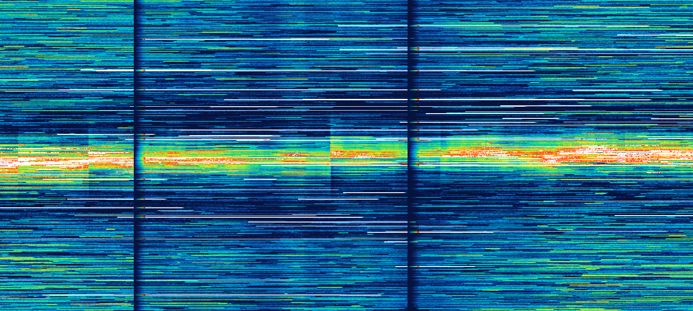
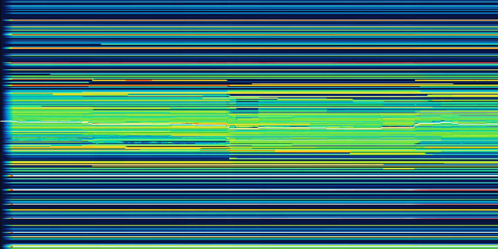
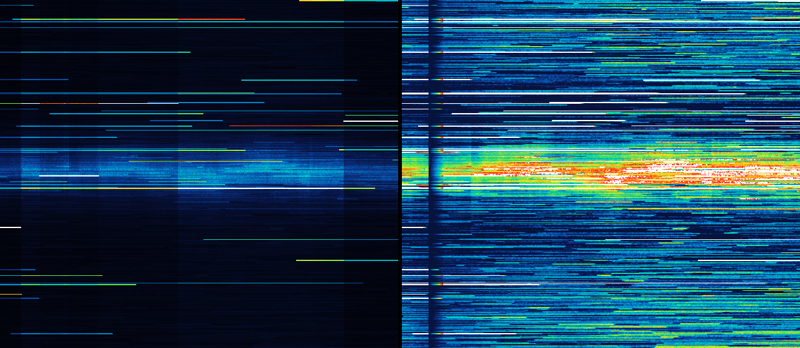
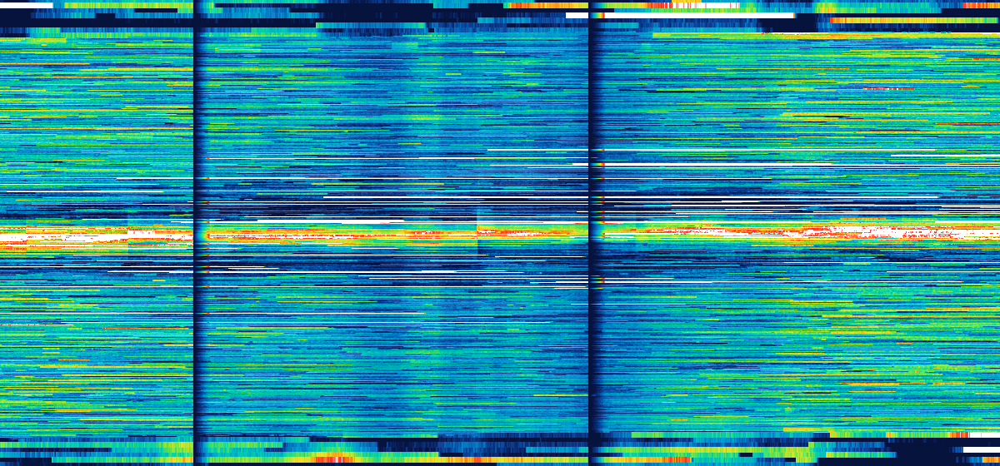

# open-dom-heatmap

[](https://github.com/Kessler833/open-dom-heatmap/actions/workflows/test.yml)   

**An open-source, Bookmap-style DOM heatmap engine for developers.** It turns order-book depth (resting size per price
level over time) into a clean, stable liquidity heatmap — the colouring algorithm, a parallel history backfill and a fast
canvas renderer, a ready-made chart component and order-book helpers, in plain JavaScript with zero dependencies (TypeScript
types included). Drop it into your own trading tool, crypto dashboard, order-flow app or research notebook.



*Synthetic order book (`demo/synth.js`), full bucket resolution, gaps in the data fade back in.*

**Live demos** (run in your browser): [synthetic book with sliders for every setting](https://kessler833.github.io/open-dom-heatmap/demo/) ·
[live Binance BTC / ETH / SOL order book](https://kessler833.github.io/open-dom-heatmap/demo/live.html)



*Real data: ten minutes of the Binance BTC/USDT spot book (`demo/live-snapshot.mjs`), $5 buckets, white = mid price.*

> Not affiliated with Bookmap or ATAS. "Bookmap-style" describes the kind of picture (a liquidity / depth-of-market
> heatmap with percentile cut-offs); the algorithm is an independent implementation. Data feeds are not included — you
> bring the order book (any exchange, crypto or futures).

## Why another order-book heatmap?

Most open-source order-book heatmaps colour each cell by `size ÷ largest size`. With a real book this leaves nearly
everything black except a few huge orders, and a single big order rescales the whole picture:



*Left: naive `size ÷ max`. Right: open-dom-heatmap, same data and zoom.*

This engine colours every level **against its own surroundings**, stretches the result between **percentile cut-offs**
that are recalibrated over time, and keeps the picture calm — so you see the structure of the book, not just its outliers.

## Features

- **Local × wide background** per column: geometric mean of the non-empty buckets within ±30 and ±200 buckets, O(n) per
  column via prefix sums of log sizes, smoothed over time per absolute price bucket.
- **Percentile cut-offs** (`lowCut` / `highCut`) on the log ratio size / background, recalibrated over ~40 columns.
- **Calm picture**: time smoothing, persistence (levels fade out instead of vanishing), a base tone inside the book (no
  black holes), fade-in after a start or data gap.
- **Bounded memory**: each price bucket forgets its state after 400 columns without an update — no "ghost walls" when
  price returns to a level after hours, and it makes the next point possible:
- **Exact parallel backfill**: long histories are split into chunks for web workers; each chunk warms up on the columns
  before it and reproduces the single sequential chain (measured mean difference 0.000 of 255 steps).
- **Optional far depth**: a coarse whole-book array (e.g. 20 bp buckets) beyond your detailed window, on the same colour
  scale and blended in at the window's edge — no hard step where the detailed data ends.
- **Volume-dominance renderer**: zoomed out, many price buckets and time columns share a pixel; the level with the most
  volume keeps its colour (score = colour × √(size / largest size)), so walls stay visible lines:



- **Incremental scroll**: a new column shifts the image and draws only the live edge (under 1 ms at 1440 × 800).
- **Ready-made chart** (`DomHeatmap`): zoom, pan, follow the live edge, HiDPI, mid-price line, custom overlays.
- **Order-book helpers** (`bookToColumn`, `Columnizer`): from any book shape (Map, `[price, size]` pairs as exchanges send
  them, or an object) to heatmap columns, sampled on a fixed interval with an optional spike filter.
- **Zero dependencies**, ES modules, browser (canvas, workers) and Node; TypeScript declarations included.

## Quick start

```bash
git clone https://github.com/Kessler833/open-dom-heatmap.git
cd open-dom-heatmap
npm test
npm run demo
```

Then open `http://localhost:8765/demo/` (synthetic data) or `http://localhost:8765/demo/live.html` (live Binance book).
A local web server is needed because the demos use module workers.

### From a live order book to a heatmap in a few lines

```html
<canvas id="heat" style="width: 100%; height: 600px"></canvas>
<script type="module">
  import { DomHeatmap, Columnizer } from './src/index.js';

  // your order book, kept up to date by your exchange connection: Map price → size (or [price, size] pairs)
  const book = { bids: new Map(), asks: new Map() };

  const chart = new DomHeatmap(document.getElementById('heat'), { bucket: 5, colMs: 250 });
  // every 250 ms: ±200 buckets around the mid price → one column → coloured and drawn
  new Columnizer(() => book, { bucket: 5, rows: 200, colMs: 250 }, (col) => chart.push(col)).start();
</script>
```

`demo/live.js` is a complete example with the Binance depth stream (snapshot + diff updates + resync), ~70 lines.

### Lower level: processor and renderer

```js
import { StableProcessor, processHistory, HeatRenderer, bookToColumn } from './src/index.js';

// one column = summed resting size per price bucket (bids + asks); v[0] is bucket kb, i.e. price kb × bucket
const column = bookToColumn(bids, asks, { seq: 1, bucket: 5, rows: 200 });   // or build { seq, kb, v } yourself

// live: one processor per heatmap source, one call per new column (e.g. every 250 ms)
const proc = new StableProcessor({ lowCut: 35, highCut: 99 }, { bucket: 5, colMs: 250 });
const { h } = proc.process(column);   // Uint8Array, colour step 0…255 per bucket

// history: coloured in parallel; `processor` continues seamlessly after the last column
const { results, processor } = await processHistory(columns, {}, { bucket: 5, colMs: 250 });

// draw into a canvas
const img = new ImageData(width, height), buf = new Uint32Array(img.data.buffer);
new HeatRenderer().render(buf, {
  width, height, cols: columns, res: results, endIndex: columns.length - 1, xEnd: width,
  colW: 2, priceTop: 76000, priceBottom: 74000, bucket: 5,
});
ctx.putImageData(img, 0, 0);
```

## API

| Export | What it does |
| --- | --- |
| `DomHeatmap(canvas, opt)` | Ready-made chart. `setHistory(cols)`, `push(col)`, `setSettings(s)`, `setPalette(lut)`, `destroy()`; geometry `yOfPrice`, `priceOfY`, `xOfIndex`, `indexOfX`; options `bucket`, `colMs`, `settings`, `ppp`, `colW`, `rightPad`, `maxColumns`, `midLine`, `onDraw`. |
| `Columnizer(getBook, opt, onColumn)` | Samples a live book every `colMs` into columns (`start()`, `stop()`, `sample()`), spike filter on by default. |
| `bookToColumn(bids, asks, opt)` | One column (`±rows` buckets around the mid, or `kLo` / `kHi`, optional `far`). |
| `bookToBuckets(bids, asks, opt)` / `bestPrices(bids, asks)` | Size per bucket in a range / best bid and ask. |
| `StableProcessor(settings, opt)` | The colouring: `process(col)` → `{ kb, h, far }`, `reset()`, `noFadeIn()`. |
| `processHistory(cols, settings, opt, par)` | Colours a history in parallel workers → `{ results, processor }`. |
| `processSequential`, `processChunk`, `planChunks` | Single-chain and chunk building blocks (tests, custom pools). |
| `HeatRenderer({ palette })` | `render(buf, view, { shift })` into a `Uint32Array` (ImageData). |
| `buildPalette(stops, gamma)`, `CLASSIC` | 256-entry colour table from palette stops. |
| `DEFAULTS`, `STALE`, `WARM`, `PAR_MIN`, `XCAP` | Default settings and tuning constants. |

Full signatures: [`src/index.d.ts`](src/index.d.ts). Everything in one file for AI agents: [`llms-full.txt`](llms-full.txt).

## Input format

| Field | Meaning |
| --- | --- |
| `seq` | Increasing column number. A jump in `seq` means missing columns (gap). |
| `kb` | Bucket index of `v[0]` (price = `(kb + i) × bucket`). The window may move with price. |
| `v` | `Float32Array` with the resting size per bucket (bids and asks summed). `null` / empty = a gap column. |
| `raw` | Optional: sizes used for the background instead of `v` (e.g. before your own level aggregation). |
| `far` | Optional: `{ g, base, v }` coarse whole-book depth, bucket `j` = price `(base + j) × g`. Keep `g` constant. |

Pass the book at full bucket resolution over the whole range you want to show — the cost is linear in the number of
buckets (0.22 ms per column for 2401 buckets). `far` is only for depth beyond that range.

## Settings

| Setting | Default | Effect |
| --- | --- | --- |
| `lowCut` | 35 | Percent of levels (vs. their surroundings) that stay in the base tone. Higher = quieter. |
| `highCut` | 99 | Percent above which levels get the hottest colour. Lower = more levels glow. |
| `local` | 0.5 | 1 = compare with direct neighbours (single walls pop), 0 = with the wide area (zones). |
| `smooth` | 0.5 | Time smoothing of the sizes, seconds. |
| `hold` | 1.5 | Persistence, seconds: a level fades out instead of vanishing. |
| `base` | 0.07 | Base tone for empty / small levels inside the book (0 = black). |
| `contrast` | 1 | Gamma of the colour curve (> 1: middle sizes darker, big ones hotter). |
| `edge` | 0.3 | Far-depth blend width (share of each half of the detailed window). |
| `edgeCurve` | `log` | Far-depth blend shape: `log`, `lin`, `smooth`, `exp`. |
| `edgeStr` | 0.5 | Far-depth blend strength; darkening counts it twice (it rather dims too little). |

## Benchmarks

`npm run bench`: synthetic history, 7200 columns (30 minutes of 250 ms columns) × 2401 buckets + 501 far buckets,
16-core desktop, Node 24:

| | |
| --- | --- |
| Processing | 0.22 ms per column (one thread) |
| History, sequential | 1.62 s |
| History, parallel (8 workers incl. start-up and copying) | 0.60 s (2.7× faster), mean difference 0.000 / 255 |
| Full frame 1440 × 800 | 24 ms (1 column per px), 43 ms (2 columns per px) |
| Incremental frame (new column) | 0.6 ms |

## How it works

1. **Background.** For each column, `lnBackground` computes the mean of `ln(size)` over the non-empty buckets within ±30
   and ±200 buckets from prefix sums (O(n)), blended by `local`. Per absolute price bucket this background is smoothed in
   the log domain (EMA, τ = 20 columns, faster upwards).
2. **Cut-offs.** The log ratio `ln(size) − ln(background)` of every bucket goes into a 256-bin histogram; its `lowCut` and
   `highCut` percentiles (EMA, τ = 40 columns) define the stretch onto 0…1, then `contrast` is applied as a gamma.
3. **Calm.** Sizes are smoothed over time, the output decays by `exp(−Δt / hold)` instead of dropping, and buckets inside
   the book get at least the base tone.
4. **Bounded memory.** Each bucket stores the column of its last update: all its time filters run over its own elapsed
   columns, state older than 400 columns resets, and a vanished size counts as empty once it fades below 2 % of its
   background (an exponential decay never reaches 0 on its own).
5. **Parallel backfill.** Because the state only depends on the last few hundred columns, a chunk that starts 600 columns
   early and discards that warm-up ends up in the same state as the full chain. `processHistory` runs the
   chunks in a pool of module workers and returns a processor that continues live.
6. **Rendering.** Per pixel the overlapping buckets and columns are combined by volume dominance; past columns never change,
   so new columns only shift the image and draw the edge.

## Use cases

Crypto and futures order-flow tools, DOM / depth-of-market visualisation, liquidity heatmaps in trading dashboards,
market-microstructure research, replaying recorded order books, teaching how limit-order books behave.

## Project layout

```
src/processor.js   StableProcessor — the colouring
src/backfill.js    processHistory (parallel), processSequential, chunk planning
src/worker.js      module worker for processHistory
src/render.js      HeatRenderer, buildPalette
src/book.js        bookToColumn, bookToBuckets, bestPrices, Columnizer
src/chart.js       DomHeatmap — ready-made canvas chart
src/index.d.ts     TypeScript declarations
demo/              synthetic and live (Binance) demos, synthetic data generator, PNG snapshots for this README
test/test.mjs      node --test
bench/bench.mjs    benchmark
```

## License

[MIT](LICENSE) © Hannes Kapsch
